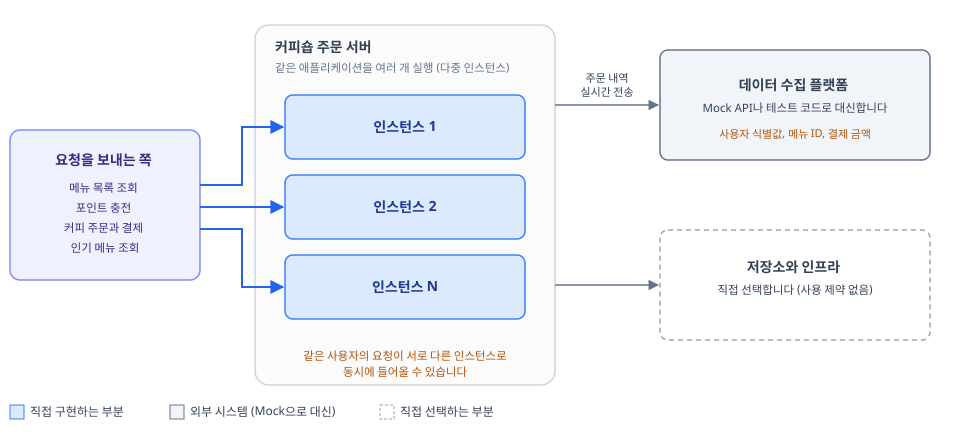

# 커피숍 주문 시스템

> 백엔드 실습 과제 (문서 버전 v1.0, 2026-10-19)

> [!IMPORTANT]
> **과제 시작 전 확인 사항**
> - 이 과제는 기존 과제들과 달리 요구사항이 명확하게 정의되어 있지 않습니다.
> - 채용 과제는 명확한 정답이 있는 과제가 아닙니다. 왜 이런 구조로 설계했는지 본인의 논리로 설명하고 설득할 수 있어야 합니다.
> - 설계 내용을 정리한 뒤 바로 구현하지 말고, 튜터와 설계 점검을 먼저 진행한 후 구현을 시작하기를 권장합니다.

> [!TIP]
> - 과제의 전체 흐름을 파악하기 어렵다면 [`docs/requirements-overview.pdf`](docs/requirements-overview.pdf)를 먼저 확인해 주세요.
>   - 3페이지 분량의 요약 자료로, 그림을 통해 과제의 주요 내용을 빠르게 파악할 수 있습니다.
> - 세부 요구사항은 README를 기준으로 확인해 주세요.

## 과제 개요

- 다수 서버 환경에서도 안정적으로 동작하는 커피숍 주문 시스템을 구현합니다.
- 동시성, 데이터 일관성, 확장성 관점에서 어떤 선택을 했는지 이유와 함께 드러내 주세요.
- 웹 서버만 실행되는 빈 시작 프로젝트(Java 17, Spring Boot 4.1.1, Gradle)를 제공합니다.

## 목차

- [저장소 구성](#저장소-구성)
- [1. 과제 소개](#1-과제-소개)
- [2. 시작하기](#2-시작하기)
- [3. 필수 요구사항](#3-필수-요구사항)
- [4. 도전 요구사항](#4-도전-요구사항)
- [5. 추가 조건](#5-추가-조건)
- [6. 자가 진단 체크리스트](#6-자가-진단-체크리스트)

---

## 저장소 구성

| 파일 및 폴더 | 용도 |
|---|---|
| `README.md` | 과제 설명, 요구사항, 자가 진단 체크리스트 |
| [`docs/requirements-overview.pdf`](docs/requirements-overview.pdf) | 3페이지 분량의 과제 요약 자료 |
| `starter-project/` | 과제를 시작할 빈 Spring Boot 프로젝트. 웹 서버 실행에 필요한 의존성만 들어 있습니다. |

## 1. 과제 소개

커피숍 주문 시스템을 만듭니다.

1. 커피 주문에 필요한 메뉴를 구성하고 조회할 수 있어야 합니다.
2. 커피는 포인트로 주문합니다.
3. 커피 주문 내역으로 인기 있는 메뉴를 추천합니다.

이 애플리케이션은 여러 대의 서버에서 여러 인스턴스로 실행된다고 가정합니다. 같은 사용자의 요청이 서로 다른 서버로 동시에 들어올 수 있습니다.



## 2. 시작하기

1. `starter-project/`를 IntelliJ에서 엽니다.
2. 서버를 실행합니다. 서버는 `8080` 포트에서 실행됩니다.
   ```bash
   ./gradlew bootRun
   ```

DB, 캐시 등 필요한 의존성과 인프라는 설계에 맞게 직접 추가해 주세요.

---

## 3. 필수 요구사항

아래 API 4개를 구현합니다. 단, [4. 도전 요구사항](#4-도전-요구사항)의 기술 제약사항을 미리 고려해 설계해 주세요.

1. 커피 메뉴 목록 조회 API
2. 포인트 충전 API
3. 커피 주문과 결제 API
4. 인기 메뉴 목록 조회 API

### 3-0. 문제 해결 전략 수립

아래 내용은 `README.md`에 **반드시 포함해야 합니다.**

- [ ] 설계 내용 (ERD, API 명세서)
- [ ] 설계 의도
- [ ] 선택한 문제 해결 전략과, 이 전략을 고르기 위해 분석한 내용
- [ ] 기술을 선택한 이유

### 3-1. 커피 메뉴 목록 조회 API

- [ ] 커피 정보(메뉴 ID, 이름, 가격)를 조회하는 API를 작성합니다.

### 3-2. 포인트 충전 API

- [ ] 결제는 포인트로만 할 수 있습니다. 포인트를 충전하는 API를 작성합니다.
- [ ] 사용자 식별값과 충전 금액을 입력받아 포인트를 충전합니다. (1원 = 1P)

### 3-3. 커피 주문과 결제 API

- [ ] 사용자 식별값과 메뉴 ID를 입력받아 주문하고 결제를 진행합니다.
- [ ] 결제는 포인트로만 할 수 있으며, 충전한 포인트에서 주문 금액을 차감합니다.
- [ ] 주문 내역을 데이터 수집 플랫폼으로 **실시간** 전송하는 로직을 추가합니다.
  - Mock API나 테스트 코드 등을 사용해 사용자 식별값, 메뉴 ID, 결제 금액을 전송합니다.

### 3-4. 인기 메뉴 목록 조회 API

- [ ] 최근 7일 동안 인기 있는 메뉴 3개를 조회하는 API를 작성합니다.
- [ ] 메뉴별 주문 횟수가 정확해야 합니다.

## 4. 도전 요구사항

아래 4가지를 함께 고려해 설계하고 구현해 주세요.

1. 작성한 애플리케이션이 다수의 서버에서 다수의 인스턴스로 동작하더라도 기능에 문제가 없도록 설계합니다.
2. 동시성 이슈를 고려해 구현합니다.
3. 데이터 일관성을 고려해 구현합니다.
4. 각 기능과 제약사항에 대한 테스트를 작성합니다.

## 5. 추가 조건

- 인프라 사용에는 제약이 없습니다.
- API의 HTTP 메서드(`GET`, `POST`, `PUT`, `DELETE`)는 자유롭게 선택합니다.
- 에러 응답과 에러 코드는 자유롭게 정의합니다.

## 6. 자가 진단 체크리스트

제출하기 전에 아래 항목을 스스로 점검해 주세요.

| 구분 | 수준 | 항목 |
|---|---|---|
| 완성도 | 필수 | 커피 메뉴 목록 조회 API를 요구사항에 맞게 구현하였는가? |
| | 필수 | 포인트 충전 API를 요구사항에 맞게 구현하였는가? |
| | 필수 | 커피 주문과 결제 API를 요구사항에 맞게 구현하였는가? |
| | 필수 | 인기 메뉴 목록 조회 API를 요구사항에 맞게 구현하였는가? |
| | 도전 | 다수의 서버와 다수의 인스턴스 환경에서도 기능이 정상적으로 동작하도록 설계되었는가? |
| | 도전 | 동시 요청 상황에서도 정합성이 깨지지 않도록 구현되었는가? |
| | 도전 | 트랜잭션 관점에서 데이터 일관성이 보장되도록 처리되었는가? |
| | 도전 | 각 기능과 제약사항에 대해 단위 테스트가 작성되었는가? |
| 이해도 | 필수 | TIL에 트러블슈팅 과정을 기록하였는가? (과제 제출란에 TIL 링크를 제출해 주세요.) |
| | 도전 | 디렉토리와 파일을 분리하였는가? |
| | 도전 | 변수명 등 코드를 직관적이고 이해하기 쉽게 작성하였는가? |
| | 도전 | 주석을 활용해 코드를 설명하였는가? |
| 우수성 | 필수 | README를 작성해 과제를 소개하였는가? |
| | 도전 | 특수 상황에 대한 예외 처리를 2가지 이상 구현하였는가? |
| | 도전 | 커밋 컨벤션을 지킨 커밋을 10회 이상 하였는가? |
